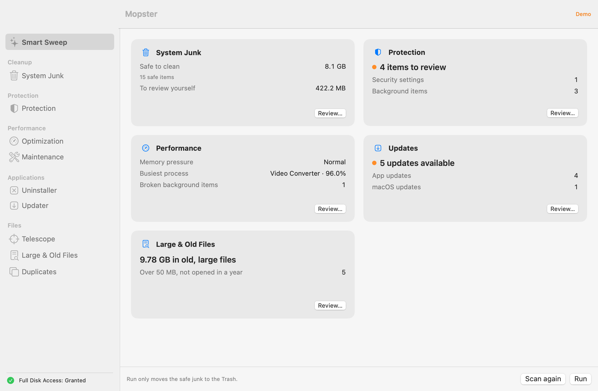
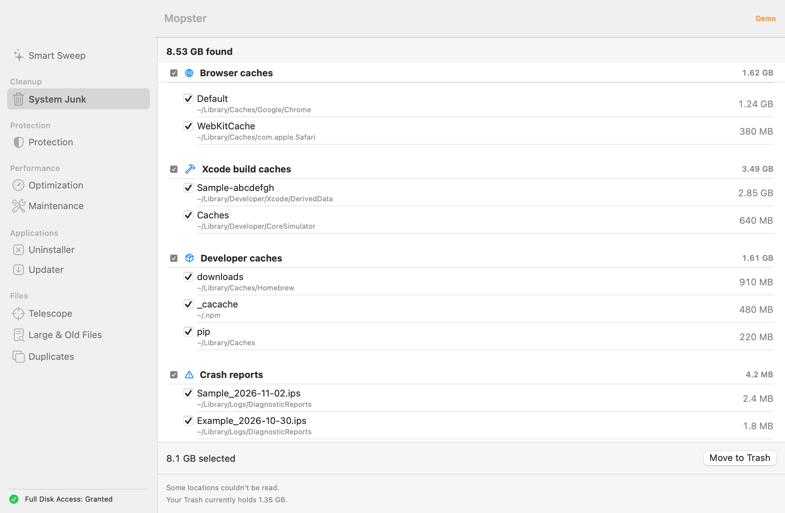
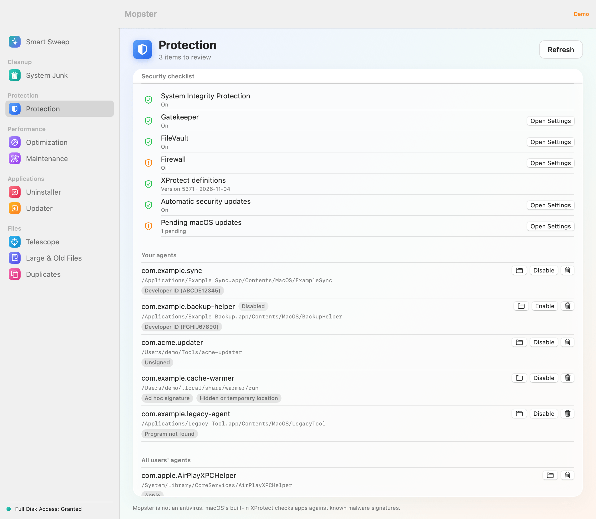
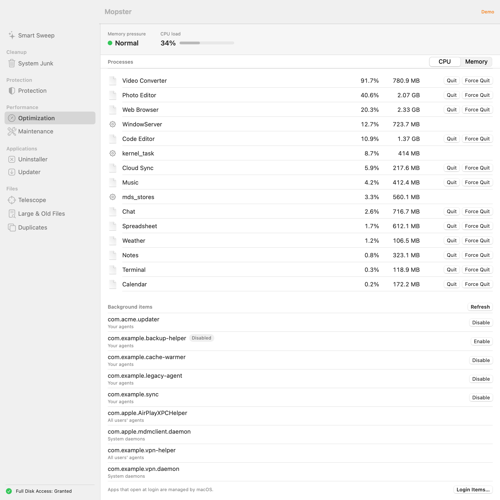
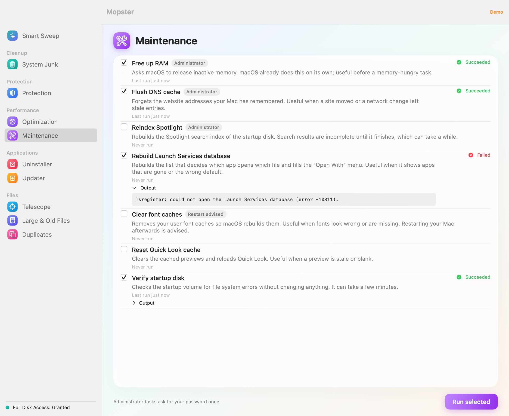
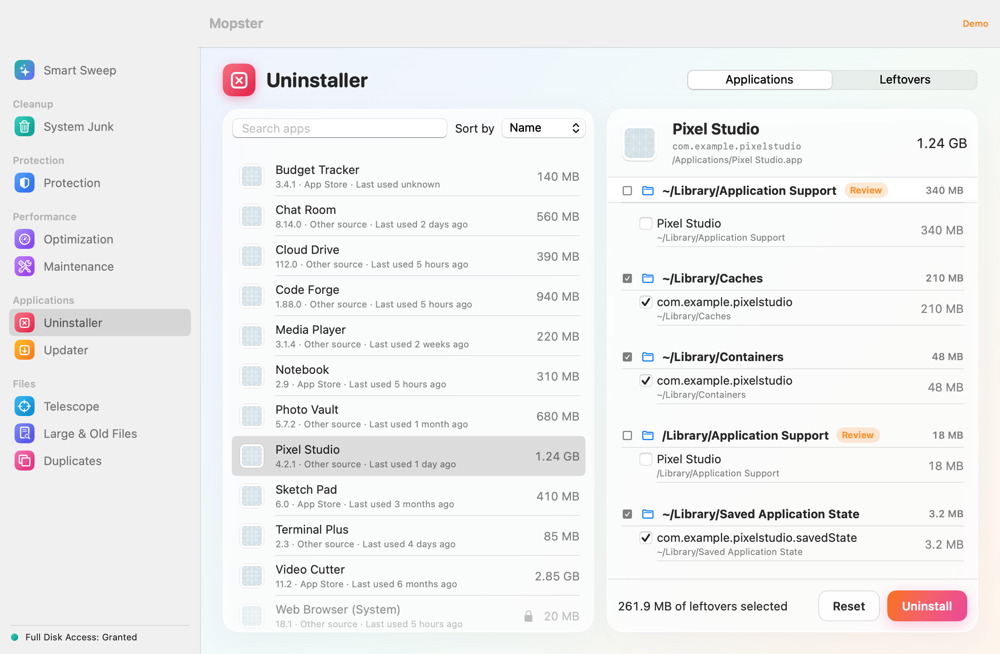
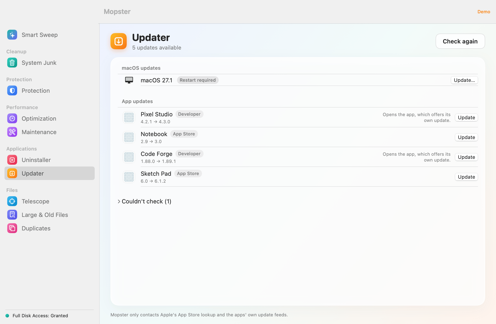
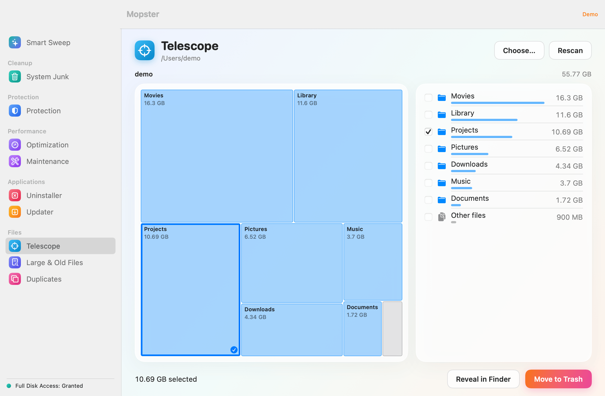
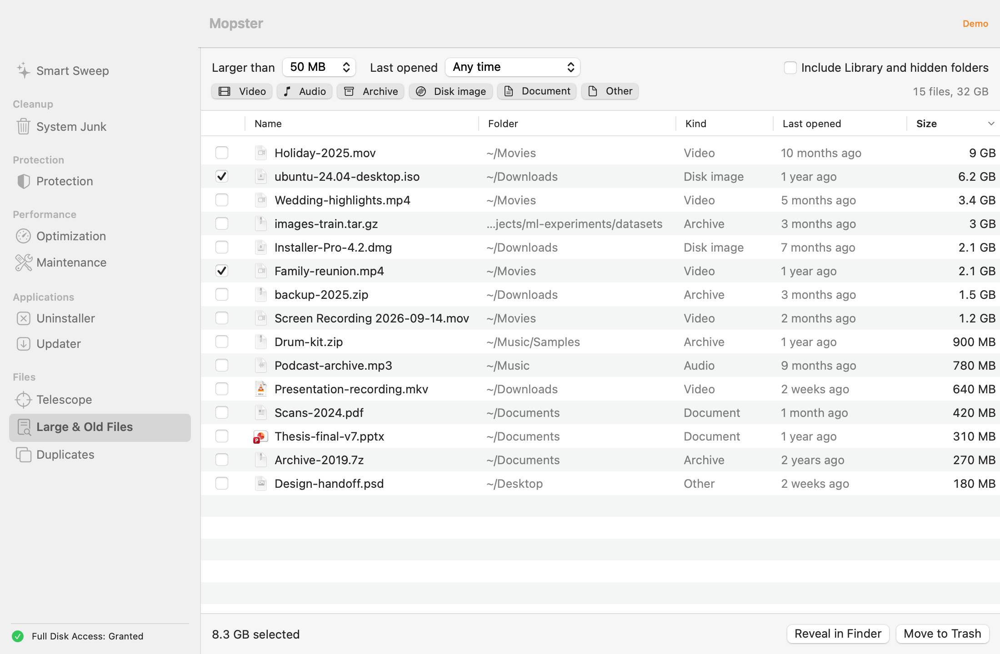
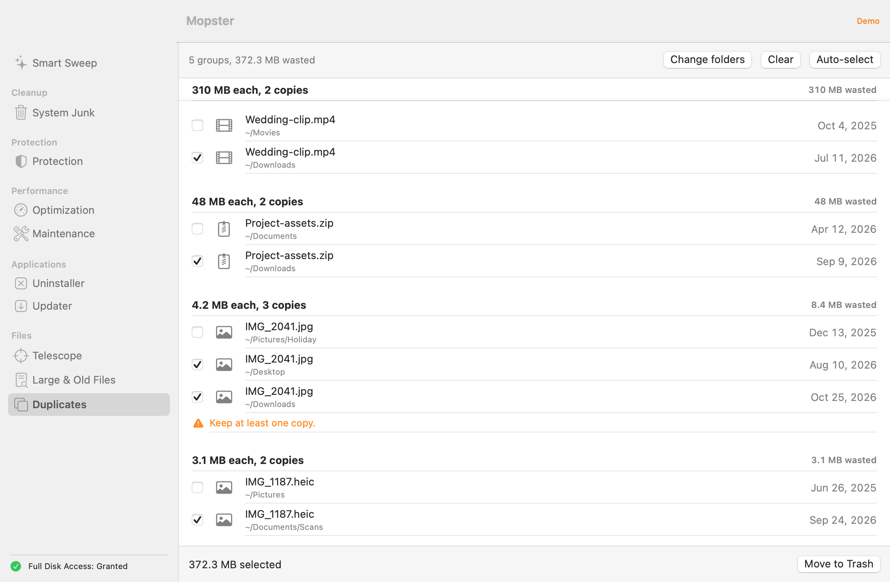

<p align="center">
  
</p>

<h1 align="center">Mopster</h1>

<p align="center">
  <strong>Une application de maintenance gratuite et open source pour macOS.</strong><br>
  Nettoyez les fichiers inutiles, vérifiez vos réglages, supprimez des apps et trouvez ce qui remplit votre disque. Chaque module montre ce qu'il a trouvé avant tout déplacement.
</p>

<p align="center">
  <a href="https://github.com/romainrg/Mopster/releases/latest"></a><br>
  <sub>Gratuit et open source · macOS 14 ou ultérieur · Apple silicon et Intel</sub>
</p>

<p align="center">
  <a href="https://github.com/romainrg/Mopster/actions/workflows/ci.yml"></a>
  
  <a href="LICENSE"></a>
</p>

<p align="center"><a href="README.md">English version</a></p>

<picture>
  <source media="(prefers-color-scheme: dark)" srcset="docs/images/smartSweep-results-dark.png">
  
</picture>

Mopster est une application de maintenance pour Mac dans l'esprit de CleanMyMac, sans abonnement, sans télémétrie et sans alarmisme. Une seule fenêtre nettoie les fichiers inutiles, vérifie vos réglages de sécurité, désinstalle les apps avec leurs fichiers résiduels, trouve les fichiers volumineux, anciens ou en double, et montre ce qui remplit votre disque.

Tout ce que Mopster supprime va à la Corbeille, après un contrôle de sécurité, et uniquement ce que vous avez sélectionné.

> [!NOTE]
> Mopster est jeune. Il a été testé à la main sur **Apple Silicon avec macOS 27.0.1** uniquement, compilé avec Xcode 16.2. Il est construit en binaire universel, mais la version Intel n'a pas été essayée à la main. Les retours d'autres Mac et d'autres versions de macOS sont les bienvenus : [ouvrez un ticket](https://github.com/romainrg/Mopster/issues/new/choose).

## Fonctionnalités

- **Entretien intelligent** : lance en une fois les analyses rapides de chaque module et affiche une carte par domaine (fichiers inutiles, protection, performances, mises à jour, gros fichiers anciens). La carte des fichiers inutiles affiche le nombre et la taille des fichiers inutiles sûrs. *Lancer* déplace exactement ces éléments présélectionnés à la Corbeille, après une confirmation qui montre le total ; *Examiner* ouvre Fichiers inutiles pour voir chaque élément. Chaque autre carte a un bouton *Examiner* qui ouvre son module.
- **Fichiers inutiles** : caches, journaux, rapports de plantage, caches Xcode et développeur, téléchargements de Mail, états d'applications enregistrés, installeurs oubliés dans Téléchargements, sauvegardes d'appareils. Les éléments sûrs sont présélectionnés, ceux qui demandent un coup d'œil ne le sont pas.
- **Protection** : une liste de contrôle (protection de l'intégrité du système, Gatekeeper, FileVault, coupe-feu, XProtect, mises à jour de sécurité automatiques) avec un raccourci vers le bon volet de Réglages Système, et une inspection des agents et démons de lancement : signature du code, programmes manquants, emplacements inhabituels. Un signalement veut dire « jetez un œil », jamais « malware ».
- **Optimisation** : principaux processus par CPU et mémoire, pression mémoire et charge CPU, Quitter et Forcer à quitter pour vos propres processus, et éléments d'arrière-plan que vous pouvez désactiver ou réactiver.
- **Maintenance** : libérer la RAM, vider le cache DNS, réindexer Spotlight, reconstruire la base Launch Services, effacer les caches de polices, réinitialiser le cache Aperçu rapide, vérifier le disque de démarrage. Les tâches administrateur s'exécutent en un lot, avec une seule demande de mot de passe.
- **Désinstallation** : les apps avec leurs fichiers résiduels (repérés par identifiant de bundle et par nom), avec *Désinstaller* et *Réinitialiser*, plus les fichiers résiduels d'apps déjà supprimées, jamais présélectionnés.
- **Mises à jour** : apps du Mac App Store, apps Sparkle et mises à jour de macOS en attente, avec un bouton qui ouvre le bon endroit pour mettre à jour.
- **Télescope** : une carte arborescente de votre disque avec exploration, fil d'Ariane et liste triée par taille.
- **Gros fichiers anciens** : fichiers volumineux filtrés par taille, ancienneté et type, avec Aperçu rapide et Afficher dans le Finder.
- **Doublons** : fichiers identiques (taille, puis empreinte partielle, puis SHA-256). Mopster refuse de sélectionner toutes les copies d'un groupe.
- **Anglais et français**, et un **mode démo** (`make demo`) avec des données d'exemple qui ne touche à rien.

Mopster est natif (Swift, SwiftUI), n'a aucune dépendance tierce et ne fait aucun appel réseau en dehors des vérifications de mises à jour.

## Captures d'écran

<p align="center">
<picture>
  <source media="(prefers-color-scheme: dark)" srcset="docs/images/smartSweep-results-dark.png">
  
</picture>
</p>

<p align="center">
<picture>
  <source media="(prefers-color-scheme: dark)" srcset="docs/images/systemJunk-results-dark.png">
  
</picture>
</p>

<p align="center">
<picture>
  <source media="(prefers-color-scheme: dark)" srcset="docs/images/protection-results-dark.png">
  
</picture>
</p>

<p align="center">
<picture>
  <source media="(prefers-color-scheme: dark)" srcset="docs/images/optimization-dark.png">
  
</picture>
</p>

<p align="center">
<picture>
  <source media="(prefers-color-scheme: dark)" srcset="docs/images/maintenance-done-dark.png">
  
</picture>
</p>

<p align="center">
<picture>
  <source media="(prefers-color-scheme: dark)" srcset="docs/images/uninstaller-apps-dark.png">
  
</picture>
</p>

<p align="center">
<picture>
  <source media="(prefers-color-scheme: dark)" srcset="docs/images/updater-results-dark.png">
  
</picture>
</p>

<p align="center">
<picture>
  <source media="(prefers-color-scheme: dark)" srcset="docs/images/telescope-dark.png">
  
</picture>
</p>

<p align="center">
<picture>
  <source media="(prefers-color-scheme: dark)" srcset="docs/images/largeFiles-dark.png">
  
</picture>
</p>

<p align="center">
<picture>
  <source media="(prefers-color-scheme: dark)" srcset="docs/images/duplicates-dark.png">
  
</picture>
</p>

## Installation

Téléchargez les fichiers depuis la [dernière version](https://github.com/romainrg/Mopster/releases/latest). Choisissez l'un des deux installeurs :

- **DMG** : ouvrez `Mopster-<version>.dmg` et glissez **Mopster** dans le dossier **Applications**.
- **PKG** : double-cliquez sur `Mopster-<version>.pkg` et suivez l'installeur. Il installe toujours dans `/Applications`.

Aucun des deux n'est notarisé par Apple (cela demande un compte développeur payant), donc macOS bloque la première ouverture. Essayez de l'ouvrir une fois, puis allez dans **Réglages Système › Confidentialité et sécurité**, faites défiler et cliquez sur **Ouvrir quand même** à côté du message concernant Mopster (ou l'installeur, pour le PKG). Vous pouvez aussi retirer vous-même l'attribut de quarantaine :

```sh
xattr -dr com.apple.quarantine /Applications/Mopster.app
# pour l'installeur, avant de l'ouvrir :
xattr -dr com.apple.quarantine ~/Downloads/Mopster-<version>.pkg
```

Vérifiez votre téléchargement avec les sommes de contrôle publiées avec la version, depuis le dossier qui contient les fichiers :

```sh
shasum -a 256 -c SHA256SUMS
```

**Prérequis :** macOS 14 Sonoma ou ultérieur.

## Autorisations

| Autorisation | Pourquoi | Où |
|---|---|---|
| **Accès complet au disque** | Permet à Mopster de lire les téléchargements de Mail, le cache de Safari, la taille de la Corbeille et certains conteneurs d'apps. Sans lui Mopster fonctionne : les analyses ignorent les endroits illisibles et le disent. | Réglages Système › Confidentialité et sécurité › Accès complet au disque |
| **Automatisation (Finder)** | Uniquement quand Mopster n'a pas le droit de déplacer lui-même un élément (par exemple des fichiers appartenant au système) : le Finder les met à la Corbeille et demande votre mot de passe. Demandée au premier besoin. | Autorisez Mopster dans la fenêtre qui s'affiche |
| **Mot de passe administrateur** | La demande standard de macOS, une fois par lot de tâches de maintenance administrateur. | |

> [!IMPORTANT]
> Mopster est signé ad hoc, et macOS lie les autorisations à la version exacte de l'app. **Après une mise à jour, ou après une recompilation depuis les sources**, retirez Mopster de l'Accès complet au disque (bouton −) puis ajoutez-le à nouveau.

## Sécurité

- **Corbeille uniquement.** Supprimer signifie `FileManager.trashItem`, avec le Finder en secours quand Mopster n'a pas le droit de déplacer lui-même un élément. Mopster ne vide jamais la Corbeille : l'écran de fin vous rappelle que l'espace n'est libéré que lorsque vous le faites.
- **`SafetyGuard`** contrôle chaque élément au moment de son retrait, donc un chemin remplacé après l'analyse est tout de même refusé. Télescope et Doublons vérifient aussi en amont et désactivent les lignes que le garde refuserait. Les liens symboliques sont résolus, les chemins système et Mopster lui-même sont refusés, et en cas de doute il refuse.
- **Endroits protégés.** Les dossiers structurels (votre dossier personnel, Bureau, Documents, `~/Library` et ses enfants directs...) ne sont jamais supprimés eux-mêmes, seulement leur contenu. Les stockages de secrets (`~/.ssh`, `~/.gnupg`, `~/.aws`, `~/.kube`, trousseaux, iCloud Drive) sont totalement interdits.
- **Vous décidez.** Chaque module montre ce qu'il a trouvé avant tout déplacement ; le bouton Lancer de l'Entretien intelligent déplace exactement les éléments sûrs présélectionnés, après une confirmation qui montre le total. Les éléments incertains démarrent désélectionnés. Les fichiers résiduels d'apps déjà supprimées sont à examiner. Les doublons conservent toujours au moins une copie.
- **Le désinstalleur regarde vos autres apps**, pour que supprimer une app n'emporte pas les données d'une autre.
- **La maintenance ne supprime jamais vos données**, et un test fige la liste des commandes qu'elle peut lancer.
- **Réseau.** Uniquement l'API de recherche iTunes, les flux Sparkle propres aux apps en https, et `softwareupdate`. Aucune statistique d'usage. Pour vérifier les mises à jour, Mopster envoie les identifiants de bundle de vos apps de l'App Store et votre pays au service de recherche iTunes d'Apple, et récupère le flux de mise à jour propre à chaque app Sparkle. Rien d'autre ne quitte votre Mac.

Les détails sont dans [docs/ARCHITECTURE.md](docs/ARCHITECTURE.md) (en anglais).

## Valeurs par défaut à connaître

- La carte des gros fichiers anciens de l'Entretien intelligent compte les fichiers de **50 Mo ou plus qui n'ont pas été ouverts depuis un an ou plus**.
- « Dernière ouverture » repose sur les dates d'accès des fichiers. Les sauvegardes ou l'indexation peuvent les rafraîchir, donc Mopster peut sous-estimer les fichiers anciens.
- L'allègement des instantanés locaux de Time Machine est volontairement absent : il supprime définitivement, hors de la Corbeille, et pourrait effacer votre seule sauvegarde récente.

## FAQ

**Pourquoi tout va-t-il à la Corbeille ?**
Pour que vous puissiez changer d'avis. Mopster déplace les éléments à la Corbeille et vous laisse la vider.

**Pourquoi Mopster n'est-il pas sandboxé ?**
Un outil de nettoyage doit lire `~/Library` et les données des autres apps, ce que la sandbox interdit. Le runtime renforcé est activé, et le garde-fou et la règle « Corbeille uniquement » sont appliqués dans le code et les tests.

**Pourquoi pas de destructeur de fichiers ?**
La suppression sécurisée n'a pas beaucoup de sens sur APFS et les SSD. La bonne réponse est FileVault, que Protection vérifie.

**Mopster est-il un antivirus ?**
Non. Il n'a ni base de signatures ni protection en temps réel. XProtect, intégré à macOS, fait ce travail, et Protection affiche sa version. Les signalements de persistance sont des éléments à examiner, pas des verdicts.

**Envoie-t-il des données ?**
Aucune statistique, aucune télémétrie. Les seules requêtes sont les vérifications de mises à jour : l'API de recherche iTunes, les flux Sparkle que vos apps déclarent déjà (https), et `softwareupdate`. Pour vérifier les mises à jour, Mopster envoie les identifiants de bundle de vos apps de l'App Store et votre pays au service de recherche iTunes d'Apple, et récupère le flux de mise à jour propre à chaque app Sparkle. Rien d'autre ne quitte votre Mac.

## Compiler depuis les sources

Prérequis : macOS 14 ou ultérieur, Xcode 16 ou ultérieur et [XcodeGen](https://github.com/yonaskolb/XcodeGen).

```sh
brew install xcodegen
git clone https://github.com/romainrg/Mopster.git
cd Mopster
make run
```

| Commande | Rôle |
|---|---|
| `make generate` | Génère `Mopster.xcodeproj` depuis `project.yml` |
| `make build` | Compilation Debug |
| `make test` | Tous les tests, puis `make check-strings` |
| `make core-test FILTER=SafetyGuardTests` | Tests du cœur uniquement (sans `FILTER`, tous) |
| `make run` | Compile et ouvre l'app |
| `make demo` | Lance avec des données d'exemple, sans rien toucher |
| `make screenshots` | Génère les scènes du README hors écran |
| `make check-strings` | Vérifie que chaque chaîne a une traduction française |
| `make release` | DMG, PKG et `SHA256SUMS` universels dans `build/release/` |
| `make clean` | Supprime les produits de compilation et les fichiers générés |

[CONTRIBUTING.md](CONTRIBUTING.md) (en anglais) est le guide de développement complet.

## Contribuer

Les rapports de bugs, correctifs, règles de nettoyage, traductions et nouveaux modules sont les bienvenus. Lisez d'abord [CONTRIBUTING.md](CONTRIBUTING.md) et le [Code de conduite](CODE_OF_CONDUCT.md) (en anglais). Si vous travaillez avec un agent de code IA, indiquez-lui [AGENTS.md](AGENTS.md).

Une faille de sécurité ? Signalez-la en privé, comme décrit dans [SECURITY.md](SECURITY.md).

## Feuille de route

- Signature Developer ID et notarisation, pour une installation sans l'étape « Ouvrir quand même ».
- Une version pour le Mac App Store, qui demande sa propre conception (sandbox, fonctionnalités réduites).
- Agent d'arrière-plan, analyses planifiées et moniteur dans la barre des menus.
- Nettoyage de confidentialité (historique et cookies des navigateurs), gestionnaire d'extensions, détecteur de photos similaires, mises à jour Homebrew.
- Allègement des instantanés Time Machine, avec une conception « lister puis confirmer ».

Idées et retours bienvenus dans les [tickets](https://github.com/romainrg/Mopster/issues).

## Licence

Mopster est publié sous [licence MIT](LICENSE). © 2026 Romain Gallien.
