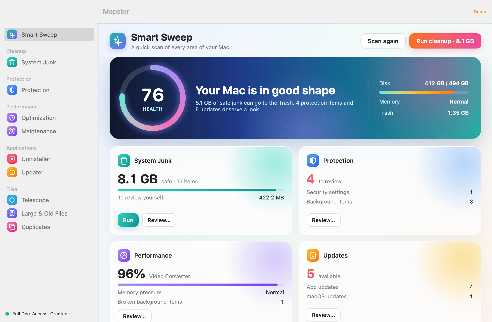
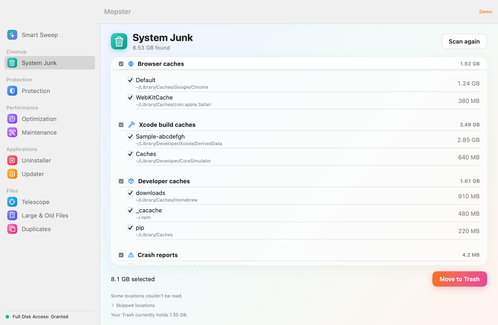
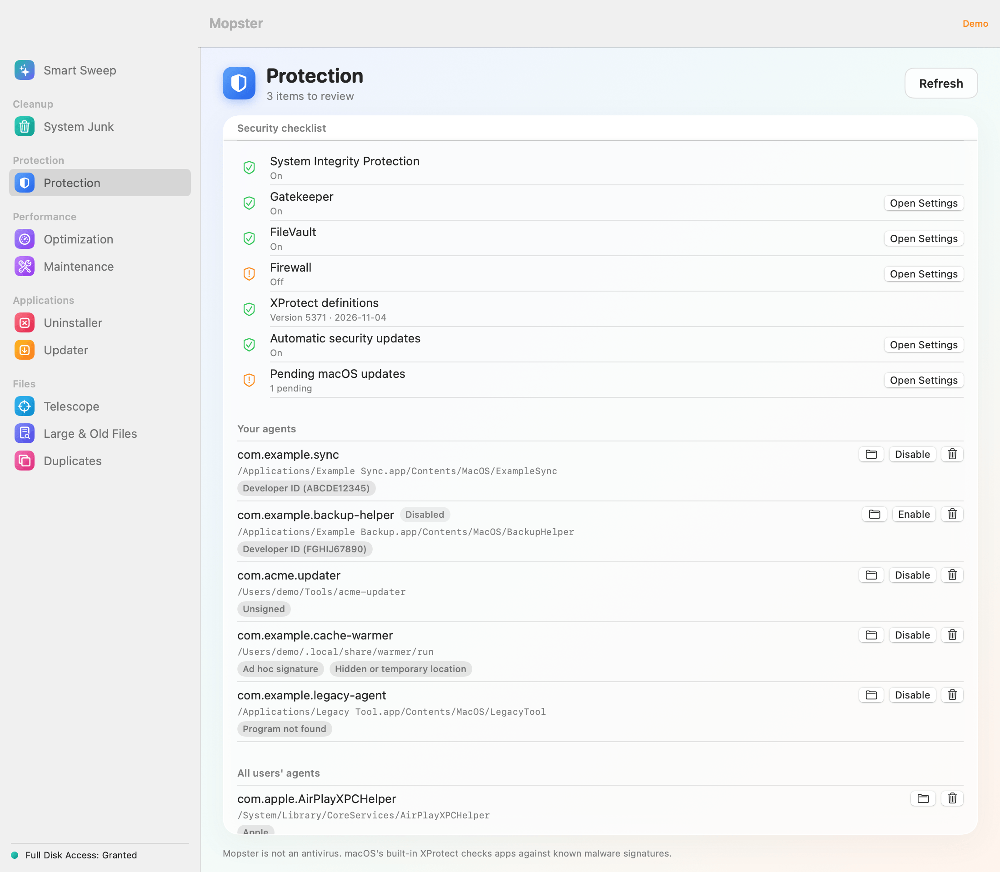
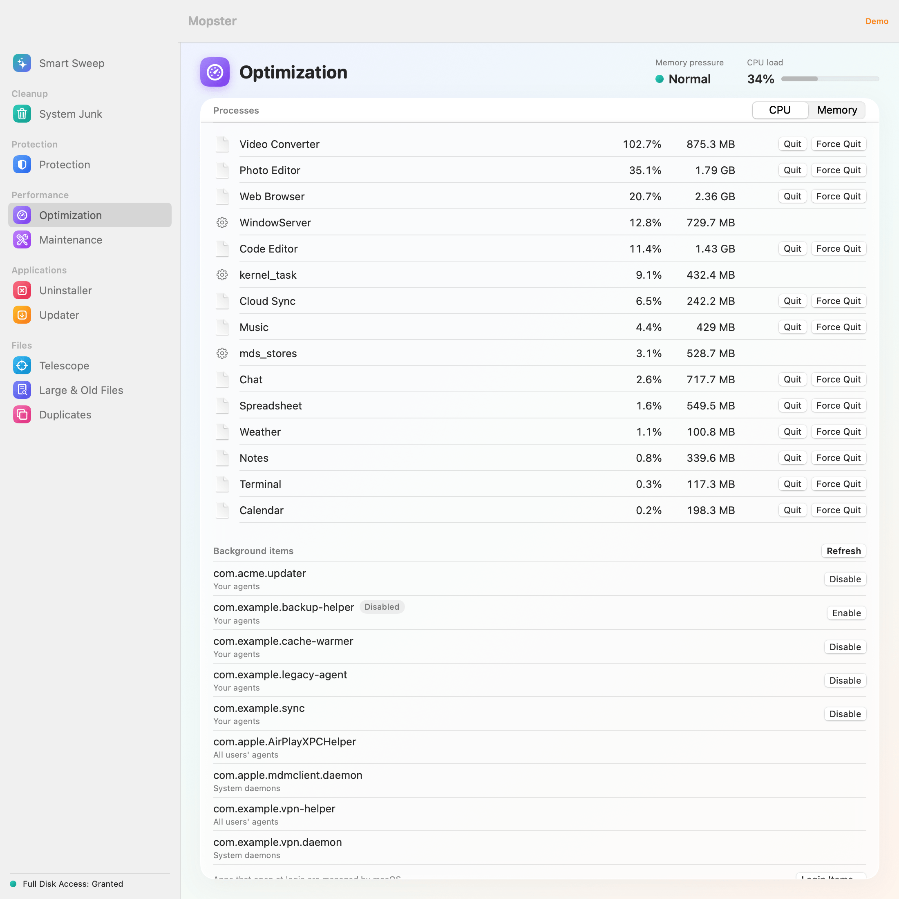
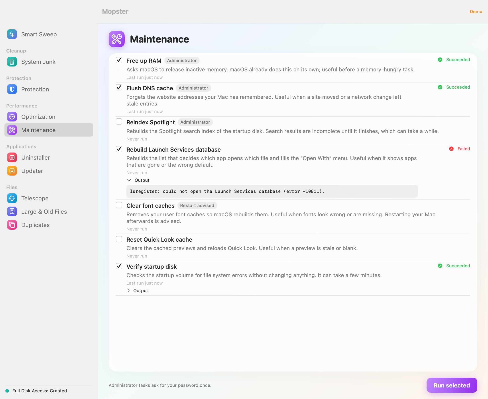
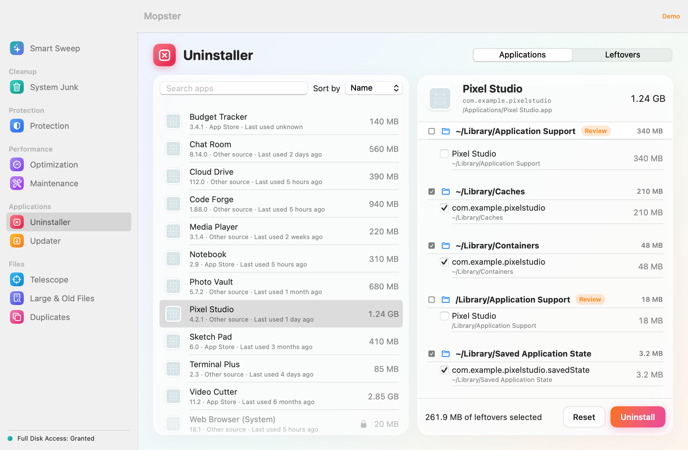
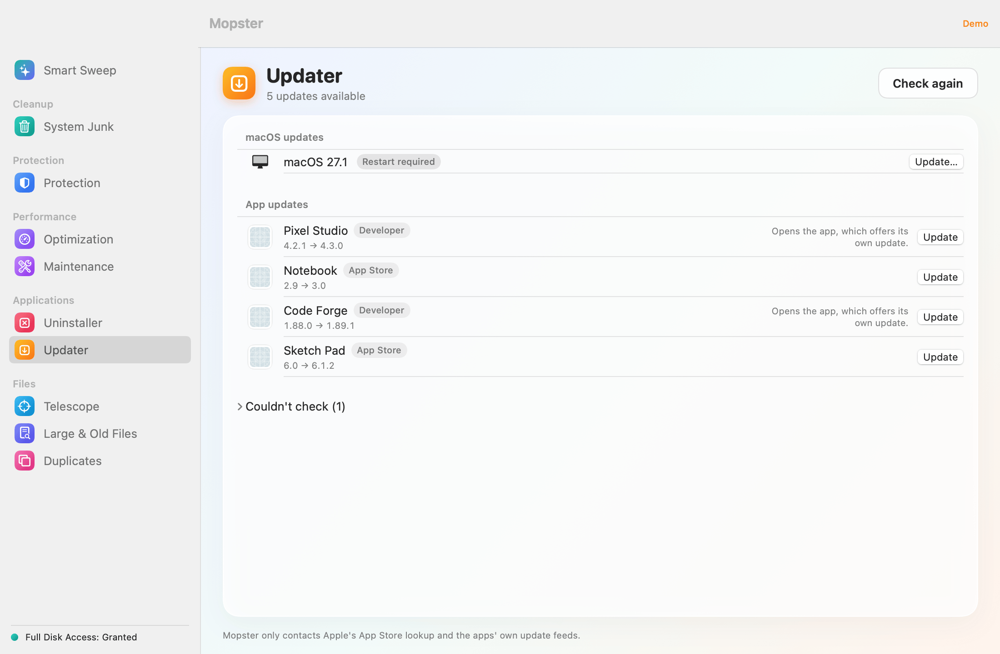
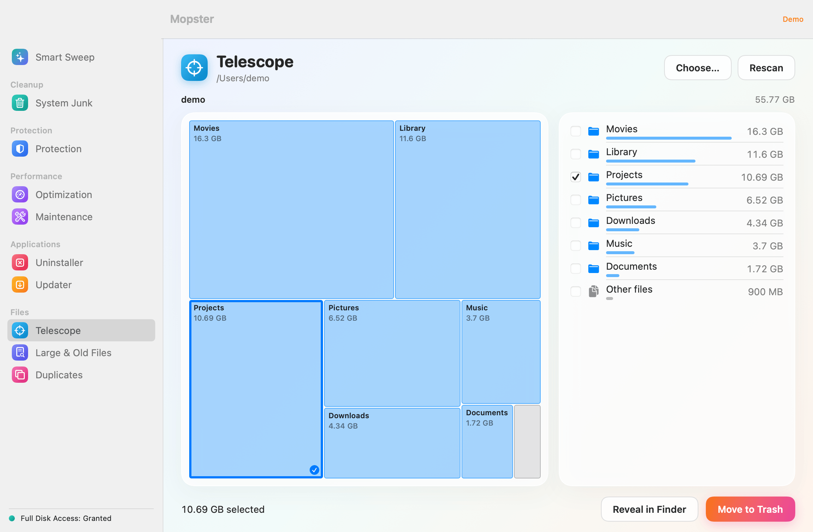
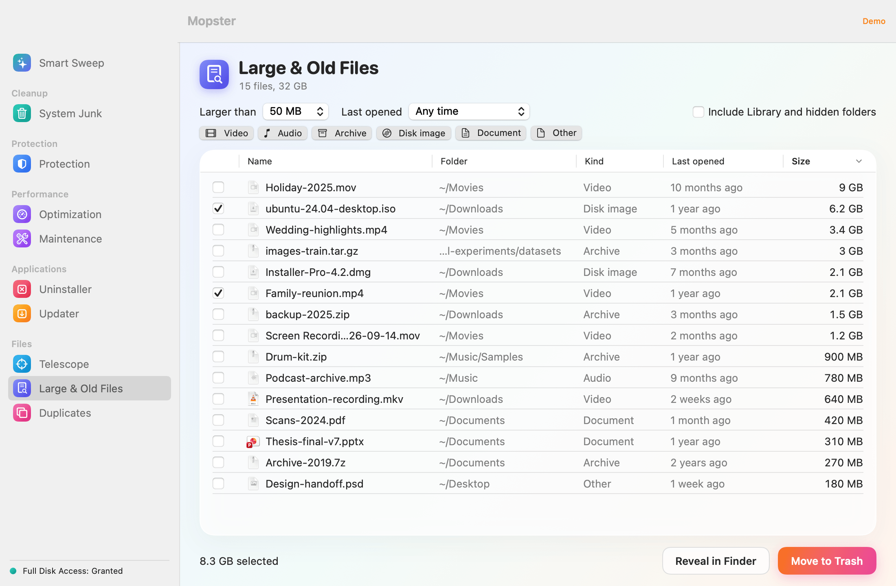
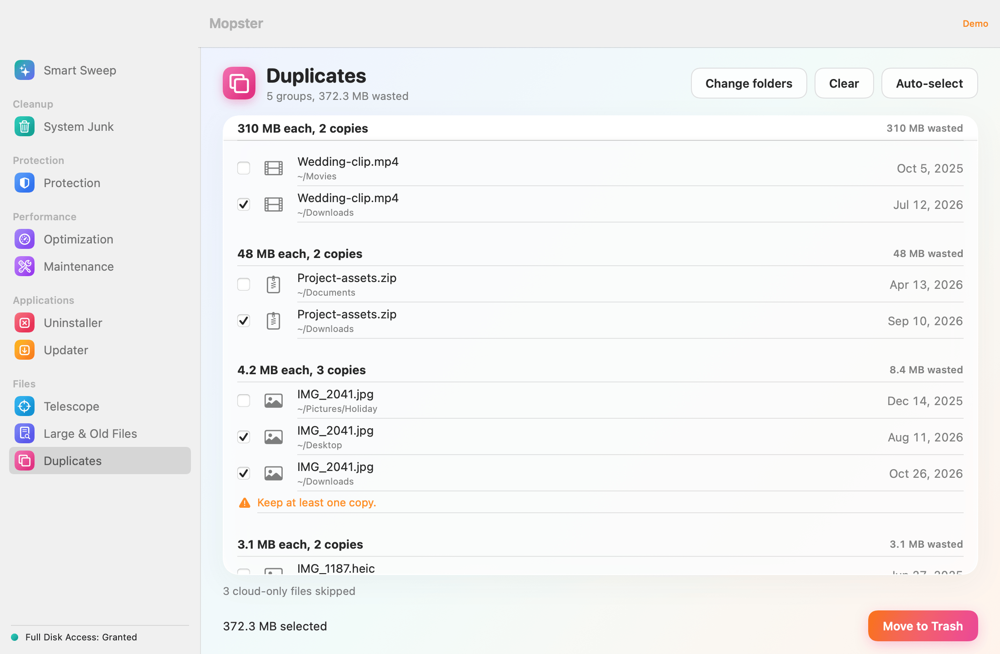

<p align="center">
  
</p>

<h1 align="center">Mopster</h1>

<p align="center">
  <strong>A free, open-source maintenance app for macOS.</strong><br>
  Clean junk, check your settings, remove apps and find what fills your disk. Every module shows what it found before anything moves.
</p>

<p align="center">
  <a href="https://github.com/romainrg/Mopster/releases/latest"></a><br>
  <sub>Free and open source · macOS 14 or later · Apple silicon and Intel</sub>
</p>

<p align="center">
  <a href="https://github.com/romainrg/Mopster/actions/workflows/ci.yml"></a>
  
  <a href="LICENSE"></a>
</p>

<p align="center"><a href="README.fr.md">Version française</a></p>

<picture>
  <source media="(prefers-color-scheme: dark)" srcset="docs/images/smartSweep-results-dark.png">
  
</picture>

Mopster is a Mac maintenance app in the spirit of CleanMyMac, with no subscription, no telemetry and no scare tactics. One window cleans junk, checks your security settings, uninstalls apps with their leftovers, finds large, old and duplicate files, and shows what fills your disk.

Everything Mopster removes goes to the Trash, after a safety check, and only what you selected.

> [!NOTE]
> Mopster is young. It was tested by hand on **Apple Silicon with macOS 27.0.1** only, built with Xcode 16.2. It is built as a universal binary, but the Intel build has not been tried by hand. Reports from other Macs and macOS versions are welcome: [open an issue](https://github.com/romainrg/Mopster/issues/new/choose).

## Features

- **Smart Sweep**: runs the quick scans of every module at once, sums them up in a health score from 0 to 100 next to the disk's used space, memory pressure and the Trash size, and shows one card per area (junk, protection, performance, app updates, large and old files). The junk card shows the count and size of the safe junk. *Run* moves exactly those pre-selected safe items to the Trash after a confirmation that shows the total; *Review* opens System Junk to see each item. Every other card has a *Review* button that opens its module.
- **System Junk**: caches, logs, crash reports, Xcode and developer caches, Mail downloads, saved application state, installers left in Downloads, device backups. Safe items are pre-selected, items that need a look are not.
- **Protection**: a checklist (System Integrity Protection, Gatekeeper, FileVault, firewall, XProtect, automatic security updates) with a shortcut to the right System Settings pane, plus an inspection of launch agents and daemons: code signature, missing programs, odd locations. Flags mean "have a look", never "malware".
- **Optimization**: top processes by CPU and memory, memory pressure and CPU load, Quit and Force Quit for your own processes, and background items you can disable or enable.
- **Maintenance**: free up RAM, flush the DNS cache, reindex Spotlight, rebuild the Launch Services database, clear font caches, reset the Quick Look cache, verify the startup disk. Admin tasks run in one batch behind a single password prompt.
- **Uninstaller**: apps with their leftovers (matched by bundle identifier and name), with *Uninstall* and *Reset*, plus leftovers of apps that are already gone, never pre-selected.
- **Updater**: Mac App Store apps, Sparkle apps and pending macOS updates, with a button that opens the right place to update.
- **Telescope**: a treemap of your disk with drill-down, breadcrumb and a size-sorted list.
- **Large & Old Files**: big files filtered by size, age and kind, with Quick Look and Reveal in Finder.
- **Duplicates**: identical files (size, then partial hash, then SHA-256). Mopster refuses to select every copy of a group.
- **English and French**, and a **demo mode** (`make demo`) with sample data that touches nothing.

Mopster is native (Swift, SwiftUI), has no third-party dependencies and makes no network call other than update checks.

## Screenshots

<p align="center">
<picture>
  <source media="(prefers-color-scheme: dark)" srcset="docs/images/smartSweep-results-dark.png">
  
</picture>
</p>

<p align="center">
<picture>
  <source media="(prefers-color-scheme: dark)" srcset="docs/images/systemJunk-results-dark.png">
  
</picture>
</p>

<p align="center">
<picture>
  <source media="(prefers-color-scheme: dark)" srcset="docs/images/protection-results-dark.png">
  
</picture>
</p>

<p align="center">
<picture>
  <source media="(prefers-color-scheme: dark)" srcset="docs/images/optimization-dark.png">
  
</picture>
</p>

<p align="center">
<picture>
  <source media="(prefers-color-scheme: dark)" srcset="docs/images/maintenance-done-dark.png">
  
</picture>
</p>

<p align="center">
<picture>
  <source media="(prefers-color-scheme: dark)" srcset="docs/images/uninstaller-apps-dark.png">
  
</picture>
</p>

<p align="center">
<picture>
  <source media="(prefers-color-scheme: dark)" srcset="docs/images/updater-results-dark.png">
  
</picture>
</p>

<p align="center">
<picture>
  <source media="(prefers-color-scheme: dark)" srcset="docs/images/telescope-dark.png">
  
</picture>
</p>

<p align="center">
<picture>
  <source media="(prefers-color-scheme: dark)" srcset="docs/images/largeFiles-dark.png">
  
</picture>
</p>

<p align="center">
<picture>
  <source media="(prefers-color-scheme: dark)" srcset="docs/images/duplicates-dark.png">
  
</picture>
</p>

## Install

Download the files from the [latest release](https://github.com/romainrg/Mopster/releases/latest). Pick one of the two installers:

- **DMG**: open `Mopster-<version>.dmg` and drag **Mopster** onto the **Applications** folder.
- **PKG**: double-click `Mopster-<version>.pkg` and follow the installer. It always installs to `/Applications`.

Neither is notarized by Apple (that needs a paid developer account), so macOS blocks the first open. Try to open it once, then go to **System Settings › Privacy & Security**, scroll down and click **Open Anyway** next to the message about Mopster (or about the installer, for the PKG). Alternatively, remove the quarantine flag yourself:

```sh
xattr -dr com.apple.quarantine /Applications/Mopster.app
# for the installer, before opening it:
xattr -dr com.apple.quarantine ~/Downloads/Mopster-<version>.pkg
```

Verify your download against the checksums published with the release, from the folder that holds the files:

```sh
shasum -a 256 -c SHA256SUMS
```

**Requirements:** macOS 14 Sonoma or later.

## Permissions

| Permission | Why | Where |
|---|---|---|
| **Full Disk Access** | Lets Mopster read Mail downloads, the Safari cache, the Trash size and some app containers. Without it Mopster still works: scans skip the places they cannot read and say so. | System Settings › Privacy & Security › Full Disk Access |
| **Automation (Finder)** | Only when Mopster isn't allowed to move an item itself (for example files owned by the system): Finder moves them to the Trash and asks for your password. Requested when first needed. | Allow Mopster in the prompt |
| **Administrator password** | The standard macOS prompt, once per batch of admin maintenance tasks. | |

> [!IMPORTANT]
> Mopster is signed ad hoc, and macOS ties permissions to the exact build. **After an update, or after rebuilding from source**, remove Mopster from Full Disk Access (with the − button) and add it again.

## Safety

- **Trash only.** Removal means `FileManager.trashItem`, with Finder as a fallback when Mopster isn't allowed to move an item itself. Mopster never empties the Trash: the Done screen reminds you that space is only freed when you do.
- **`SafetyGuard`** checks every item at the moment it is removed, so a path swapped after the scan is still refused. Telescope and Duplicates also check up front and disable the rows the guard would refuse. Symlinks are resolved, system paths and Mopster itself are refused, and it fails closed.
- **Protected places.** Structural folders (your home, Desktop, Documents, `~/Library` and its direct children...) are never removed themselves, only their contents. Secret stores (`~/.ssh`, `~/.gnupg`, `~/.aws`, `~/.kube`, Keychains, iCloud Drive) are off-limits entirely.
- **You choose.** Every module shows what it found before anything moves; Smart Sweep's Run moves exactly the pre-selected safe items, after a confirmation showing the total. Uncertain items start unselected. Leftovers of already-deleted apps are review-only. Duplicates always keep at least one copy.
- **The uninstaller looks at your other apps**, so removing one app does not take another's data.
- **Maintenance never deletes your data**, and a test pins the list of commands it may run.
- **Network.** Only the iTunes lookup API, the apps' own Sparkle feeds over https, and `softwareupdate`. No analytics. To check for updates, Mopster sends the bundle identifiers of your App Store apps and your country to Apple's iTunes lookup service, and fetches each Sparkle app's own update feed. Nothing else leaves your Mac.

Details are in [docs/ARCHITECTURE.md](docs/ARCHITECTURE.md).

## Defaults worth knowing

- Smart Sweep's large and old files card counts files of **50 MB or more that have not been opened for a year or more**.
- Smart Sweep's health score starts at 100 and each finding costs a few points, capped per area: safe junk over 1 GB, security settings that are off, flagged background items, memory pressure, broken background items, pending updates and a startup disk over 80% full. An area that couldn't be checked costs nothing; 75 and above reads as good shape.
- "Last opened" relies on file access dates. Backups or indexing can refresh them, so Mopster may under-report old files.
- Thinning Time Machine local snapshots is left out on purpose: it deletes permanently, outside the Trash, and could remove your only recent backup.

## FAQ

**Why does everything go to the Trash?**
So you can change your mind. Mopster moves items to the Trash and leaves emptying it to you.

**Why is Mopster not sandboxed?**
A cleaner has to read `~/Library` and other apps' data, which the sandbox forbids. The hardened runtime is on, and the safety guard and the Trash-only rule are enforced in code and tests.

**Why is there no file shredder?**
Secure deletion does not mean much on APFS and SSDs. The right answer is FileVault, which Protection checks.

**Is Mopster an antivirus?**
No. It has no signature database and no real-time protection. macOS's built-in XProtect does that job, and Protection shows its version. Persistence flags are things to review, not verdicts.

**Does it phone home?**
No analytics, no telemetry. The only requests are the update checks: the iTunes lookup API, the Sparkle feeds that your apps already declare (https), and `softwareupdate`. To check for updates, Mopster sends the bundle identifiers of your App Store apps and your country to Apple's iTunes lookup service, and fetches each Sparkle app's own update feed. Nothing else leaves your Mac.

## Build from source

Requirements: macOS 14 or later, Xcode 16 or later and [XcodeGen](https://github.com/yonaskolb/XcodeGen).

```sh
brew install xcodegen
git clone https://github.com/romainrg/Mopster.git
cd Mopster
make run
```

| Command | What it does |
|---|---|
| `make generate` | Generate `Mopster.xcodeproj` from `project.yml` |
| `make build` | Debug build |
| `make test` | All tests, then `make check-strings` |
| `make core-test FILTER=SafetyGuardTests` | Core tests only (without `FILTER`, all of them) |
| `make run` | Build and open the app |
| `make demo` | Run with sample data, touching nothing |
| `make screenshots` | Render the README scenes offscreen |
| `make check-strings` | Check that every string has a French translation |
| `make release` | Universal DMG, PKG and `SHA256SUMS` in `build/release/` |
| `make clean` | Remove build products and generated files |

[CONTRIBUTING.md](CONTRIBUTING.md) is the full development guide.

## Contributing

Bug reports, fixes, cleanup rules, translations and new modules are welcome. Please read [CONTRIBUTING.md](CONTRIBUTING.md) and the [Code of Conduct](CODE_OF_CONDUCT.md) first. If you work with an AI coding agent, point it to [AGENTS.md](AGENTS.md).

Found a security issue? Please report it privately, as described in [SECURITY.md](SECURITY.md).

## Roadmap

- Developer ID signing and notarization, for an install without the Open Anyway step.
- A Mac App Store build, which needs its own design (sandbox, reduced feature set).
- Background agent, scheduled scans and a menu bar monitor.
- Privacy cleaner (browser history and cookies), extensions manager, similar-photo finder, Homebrew updates.
- Time Machine snapshot thinning, with a list-and-confirm design.

Ideas and feedback are welcome in the [issues](https://github.com/romainrg/Mopster/issues).

## License

Mopster is released under the [MIT License](LICENSE). © 2026 Romain Gallien.
